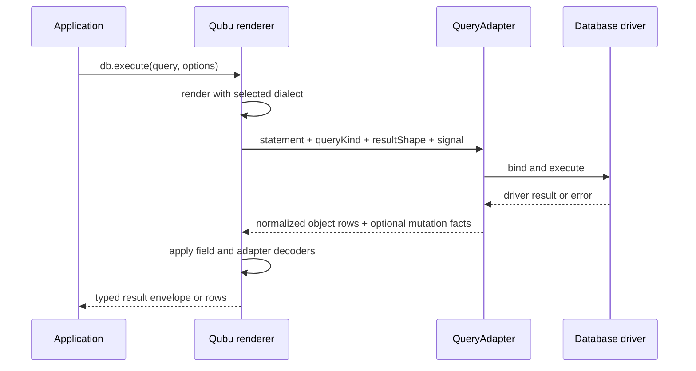

# Dialects and adapters

> Choose rendering policies or implement the driver boundary.

To run queries with an existing adapter, start with [Execute queries](guides/execution.md).
This page covers policy and adapter implementation; transactions, streams,
plans, and hooks have focused guides linked there.

## Choose a rendering policy

`render()` returns a `RenderedQuery` with SQL text and raw parameter values. The
default renderer uses Qubu's standard SQL policy. Select a concrete dialect
subpath when a driver needs another placeholder, identifier, pagination, or
capability policy:

| Dialect      | Import              | Identifiers   | Placeholders    | Pagination policy                     |
| ------------ | ------------------- | ------------- | --------------- | ------------------------------------- |
| Standard SQL | `render(query)`     | double quotes | `?`             | `OFFSET ... ROWS FETCH ... ROWS ONLY` |
| PostgreSQL   | `postgresDialect()` | double quotes | `$1`, `$2`, ... | `LIMIT ... OFFSET ...`; `ILIKE`       |
| SQLite       | `sqliteDialect()`   | double quotes | `?`             | `LIMIT ... OFFSET ...`                |
| MySQL        | `mysqlDialect()`    | backticks     | `?`             | `LIMIT ... OFFSET ...`                |

Construct the query without choosing a driver, then render it with the policy
the adapter expects:

```ts
import { eq, from, integer, render, select, table, text, where } from "qubu"
import { postgresDialect } from "qubu/postgres"

const users = table("users", { id: integer(), name: text() })
const query = select({ name: users.name }, from(users), where(eq(users.id, 7)))

const standard = render(query)
const postgres = render(query, postgresDialect())

standard.text
// ... WHERE ("users"."id" = ?)

postgres.text
// ... WHERE ("users"."id" = $1)
```

## Capability requirements

Portable syntax stays portable, while dialect-specific syntax carries a
capability requirement to the rendering boundary. For example, PostgreSQL's `ilike()` requires PostgreSQL support:

```ts
import { from, like, render, select, where } from "qubu"
import { ilike, postgresDialect } from "qubu/postgres"
import { sqliteDialect } from "qubu/sqlite"

const postgresQuery = select({ name: users.name }, from(users), where(ilike(users.name, "%ada%")))

render(postgresQuery, postgresDialect()) // supported
render(postgresQuery, sqliteDialect()) // TypeScript error
```

The same check runs at runtime when a dialect or query has been widened or
received from an untyped integration. Use the portable operator when the
query must render across dialects:

```ts
import { from, like, render, select, where } from "qubu"
import { sqliteDialect } from "qubu/sqlite"

const portableQuery = select({ name: users.name }, from(users), where(like(users.name, "%ada%")))

render(portableQuery)
render(portableQuery, sqliteDialect())
```

Custom dialects that implement a supported capability advertise it through
`createDialect({ capabilities: ['ilike'] })`. A dialect without that
advertisement is rejected for capability-bearing fragments.

Import `ilike` and `postgresDialect` from `qubu/postgres`. The root entrypoint
does not re-export concrete dialect constructors.

## The adapter owns the driver

Qubu does not open connections or bind values for a particular client. An
adapter receives an `ExecutionRequest` and returns driver-normalized object
rows. Qubu then uses the query's result shape and the adapter's decoder policy
to produce the typed `ExecutionResult`. A `TransactionalQueryAdapter` can also
pin one driver connection for a callback transaction.

`request.statement.parameterSqlTypes`, when present, lists SQL domains in
the same order as `statement.parameters`. Adapters can pass each domain to their
value encoder or driver binding layer when a client distinguishes values such
as `DATE`, `TIMESTAMP`, `UUID`, and `DECIMAL`.

```ts
import { qubu } from "qubu"
import { postgresDialect } from "qubu/postgres"
import type { ExecutionRequest, QueryAdapter } from "qubu"

declare const driver: {
  query<TRow extends object>(
    text: string,
    parameters: readonly unknown[],
    options: { signal?: AbortSignal },
  ): Promise<{ rows: readonly TRow[]; rowCount: number | null }>
}

const adapter: QueryAdapter = {
  dialect: postgresDialect(),
  async execute(request: ExecutionRequest) {
    const { statement, queryKind, signal } = request
    const result = await driver.query<Record<string, unknown>>(
      statement.text,
      statement.parameters,
      { signal },
    )
    return {
      rows: result.rows,
      ...(queryKind !== "select" && queryKind !== "set" && result.rowCount !== null
        ? { affectedRows: result.rowCount }
        : {}),
    }
  },
}
```

### Experimental cloud adapters

The workspace also publishes experimental adapters for HTTP and serverless
database clients. They are not production-ready and are intentionally outside
provider-backed CI until funded infrastructure and an external maintainer are
available.

| Package                                   | Driver boundary                        | Advertised capabilities                                                                              |
| ----------------------------------------- | -------------------------------------- | ---------------------------------------------------------------------------------------------------- |
| `@qubu/adapter-neon`                      | Neon HTTP PostgreSQL query function    | PostgreSQL rendering, object rows, mutation counts, EXPLAIN, and fetch cancellation                  |
| `@qubu/adapter-planetscale`               | PlanetScale serverless MySQL client    | MySQL rendering, rows, mutation metadata, EXPLAIN, and provider transaction callbacks                |
| `@qubu/adapter-aws-rds-data-api/postgres` | AWS RDS Data API for Aurora PostgreSQL | PostgreSQL rendering, typed Data API values/results, EXPLAIN, mutation metadata, and transaction IDs |
| `@qubu/adapter-aws-rds-data-api/mysql`    | AWS RDS Data API for Aurora MySQL      | MySQL rendering, typed Data API values/results, EXPLAIN, mutation metadata, and transaction IDs      |

Neon HTTP and the RDS Data API do not advertise interactive streaming. The
RDS adapter uses named placeholders (`:p1`, `:p2`, ...), while PlanetScale uses
the MySQL dialect and the provider's own value formatting. Read each package's
README for its experimental boundary and required provider setup.

### Official SQLite WASM adapter

`@qubu/adapter-sqlite-wasm` adapts the official SQLite WASM OO1
`sqlite3.oo1.DB` API for browser and web-worker use. It prepares one statement
per request, binds Qubu's ordered parameters, copies object rows, and finalizes
the statement in a `finally` block. SQLite's change count and generated row ID
are returned as mutation metadata when the request is a mutation.

Your application manages the worker:

1. Initialize the official SQLite module inside a dedicated worker.
2. Construct the adapter around its `sqlite3.oo1.DB`.
3. Close the adapter before terminating the worker.

Serve the package’s `sqlite3.wasm` asset beside the bundled worker module. The
combo runner’s verified browser scenario demonstrates this setup.

### Decode schema-aware result values

Portable boolean, date, timestamp, JSON, and bigint columns retain their
logical result domains through projection aliases, derived queries, CTEs, set
operations, and mutation `RETURNING`. The result field exposes that domain as
`sqlType` before execution. Register only the conversions required by the
selected driver configuration. `sqlType` identifies the SQL domain; `type` and
the selected decoder determine whether Qubu converts the returned value:

```ts
import {
  booleanResultDecoder,
  dateResultDecoder,
  jsonTextResultDecoder,
  timestampResultDecoder,
} from "qubu"
import type { AdapterExecutionResult, QueryAdapter, RenderedQuery } from "qubu"
import { sqliteDialect } from "qubu/sqlite"

declare const sqliteDriver: {
  execute(statement: RenderedQuery): Promise<AdapterExecutionResult>
}

const adapter: QueryAdapter = {
  dialect: sqliteDialect(),
  decoders: {
    boolean: booleanResultDecoder,
    date: dateResultDecoder,
    timestamp: timestampResultDecoder,
    json: jsonTextResultDecoder,
  },
  async execute(request) {
    return sqliteDriver.execute(request.statement)
  },
}
```

Qubu can decode bigint values exactly when a driver returns a bigint, a safe
integer, or an integer string. For arbitrary-precision `DECIMAL` values, keep
the driver's exact representation (usually a string or decimal object) rather
than converting it to a JavaScript number.

Do not register `jsonTextResultDecoder` when the driver already returns parsed
JSON. A JSON string is otherwise ambiguous: it may be serialized JSON or an
already-decoded JSON string scalar. With no registered JSON decoder, Qubu
preserves the driver's value. Bigint has a built-in decoder even without an
adapter registration; a registered bigint decoder overrides it.

Use a column decoder for a custom stored type, or `mapResult()` for one
expression. Both override adapter policy for that field:

```ts
import { column, mapResult, value } from "qubu"

const score = column<number>({ decode: (value) => Number(value) })
const decodedTotal = mapResult(value("42"), (value) => Number(value))
```

SQL `NULL` bypasses top-level field decoders and stays `null`; a decoder is
not a replacement for SQL `coalesce()`. Decoder exceptions become
`ResultDecodingError` without exposing the raw value.

## Result fields

| Result field   | Adapter type                         | Contract                                                                              |
| -------------- | ------------------------------------ | ------------------------------------------------------------------------------------- |
| `rows`         | `readonly Record<string, unknown>[]` | Key by rendered aliases; Qubu returns the decoded `readonly TRow[]`                   |
| `affectedRows` | `number \| bigint`                   | Rows inserted, updated, or deleted when the driver reports an affected count          |
| `changedRows`  | `number \| bigint`                   | Rows whose stored values changed when the driver distinguishes them from matched rows |
| `insertId`     | `string \| number \| bigint`         | One insert identifier when the driver reports it                                      |

The last three fields are optional. For example, an adapter can map PostgreSQL
`rowCount`, MySQL `affectedRows`, `changedRows`, and `insertId`, or SQLite
`changes` and `lastInsertRowid`. Omit a fact that the selected driver cannot
report accurately. Qubu does not derive mutation metadata from returned rows.

## Dialect overrides and errors

The adapter's `dialect` becomes the default for standalone and bound execution.
A `dialect` in the execution options overrides that rendering policy. Qubu
passes `signal`, `queryKind`, and `resultShape` to the adapter without changing
them.

The adapter decides whether and how its driver supports cancellation. Driver
errors pass through unchanged. Decoder failures become a
`ResultDecodingError` that identifies the row and field without exposing the
raw value.



## Create a small custom dialect

Use `createDialect()` when a driver needs a different policy but the query
syntax stays portable:

```ts
import { render } from "qubu"
import { createDialect } from "qubu/core"

const namedParameters = createDialect({
  name: "named-parameters",
  placeholder: (position) => `:p${position}`,
  castTypes: { text: "STRING" },
})

const statement = render(query, namedParameters)
// ... WHERE ("users"."id" = :p1)
```

`castTypes` overrides how logical targets from definitions such as `text()`
render in `CAST` expressions. Omitted entries use the standard spelling. A
custom definition's explicit `castType` is emitted verbatim instead of passing
through this map.

For syntax that is not a small policy decision, add a [custom fragment or
clause](guides/extensions/overview.md) instead of making the standard dialect
pretend that vendor behavior is portable.

> [!WARNING]
> `RenderedQuery.parameters` contains raw application values. The adapter must
> bind or encode them using the driver API; do not concatenate them into
> `RenderedQuery.text`.
